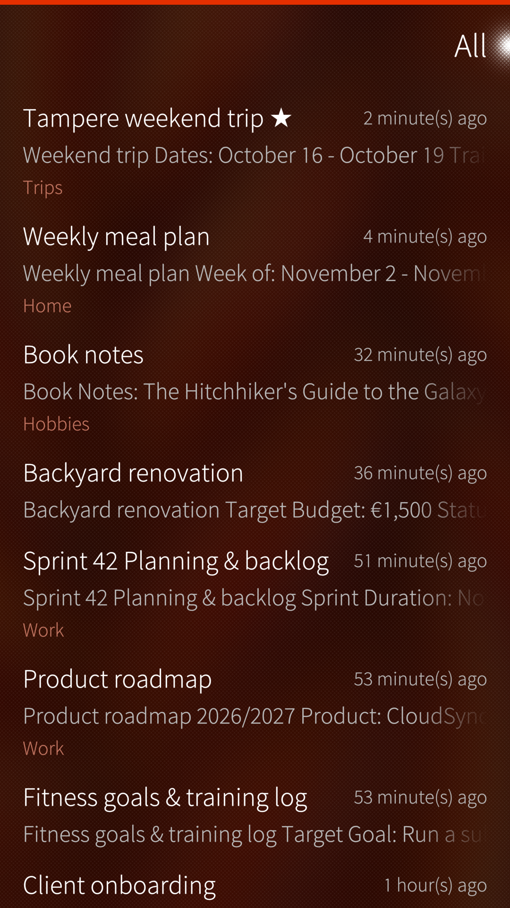
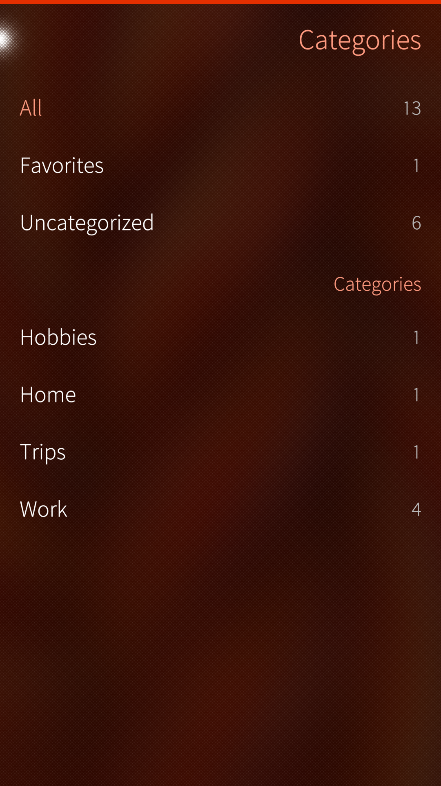
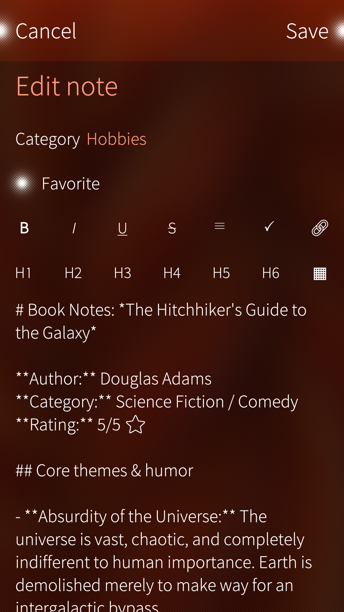

# Lappu

Lappu is a native [Nextcloud Notes](https://apps.nextcloud.com/apps/notes) client for Sailfish OS. It talks to a Nextcloud server that you already run, and keeps a copy of the notes on the device so they can be read and written while the server is out of reach.

Lappu does not use the Nextcloud account in the Sailfish OS settings. That account syncs the calendar and the files, not the notes, so this app signs in on its own.

It is a sibling to [Askare](https://github.com/fravaccaro/harbour-askare), the Nextcloud Tasks client it shares its plumbing with.

  

## Donate

The SailfishOS Community Team is on Liberapay:

## Features

  
 

- Write notes in Markdown, with a bar for emphasis, headings, lists, task lines, links and tables, and undo and redo.
- Read a table as a grid, a quote with a bar beside it and a code block as code, rather than as the markers they were written with.
- Browse by category, favourites, or everything at once, and search the title and body of every note.
- Tick a task line straight from the note, without opening the editor.
- Edit while offline: a note written with no server in reach is kept and sent by the next sync.
- Keep one note on the cover, where it survives a restart.

## Requirements

- Sailfish OS 5.0 or newer
- A reachable Nextcloud server with the Notes app

## Using Lappu

[Using Lappu](docs/guide.md) - signing in, finding your way around the notes, writing them, and how and when they sync.

## Download

RPMs are attached to the [GitHub releases](https://github.com/fravaccaro/harbour-lappu/releases/latest).

## Developers

[Developers](docs/devel/) - architecture, building, deploying and packaging (maintainers and contributors).

## Translate

Request a new language or contribute on the [Transifex project page](https://explore.transifex.com/fravaccaro/lappu).

## Credits

- [Nextcloud Notes](https://apps.nextcloud.com/apps/notes), the server app whose notes this client reads and writes.
- [Opal](https://github.com/Pretty-SFOS/opal) QML modules (About, SupportMe, LinkHandler) by [Mirian Margiani](https://github.com/Pretty-SFOS/opal-about).
- Thanks to all translators and testers.

## AI disclosure

- **Cursor-assisted work.** Lappu is developed with [Cursor](https://cursor.com) as an IDE with AI assistance, for tasks such as scaffolding, documentation, translation upkeep and RPM packaging. Output is reviewed and edited by the maintainer before commit.
- **Not a substitute for testing.** AI suggestions do not replace testing on Sailfish OS hardware, reading the code, or applying your own knowledge. Generated changes are treated like any other patch: understand it, test it, then ship it.

## Licence

[GPL-3.0-only](https://github.com/fravaccaro/harbour-lappu/blob/main/LICENSE)
